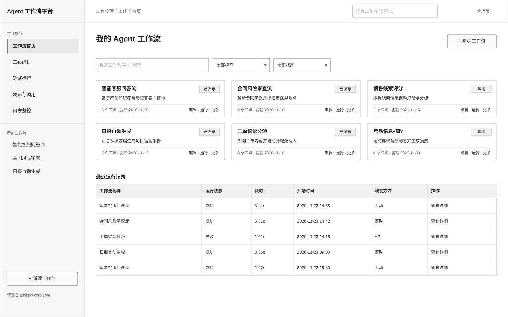
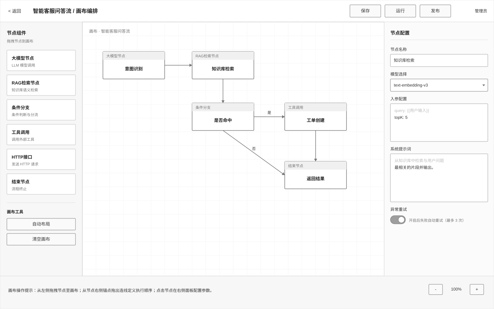
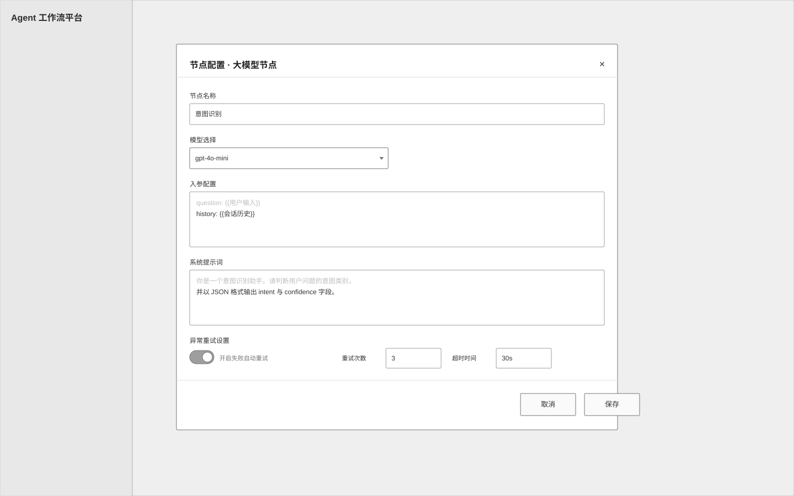
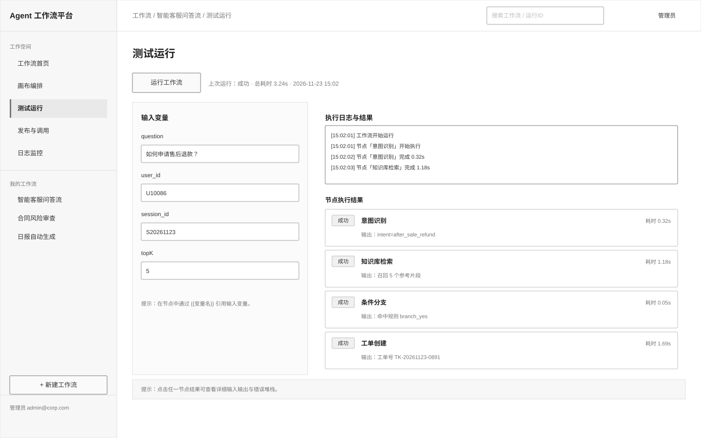
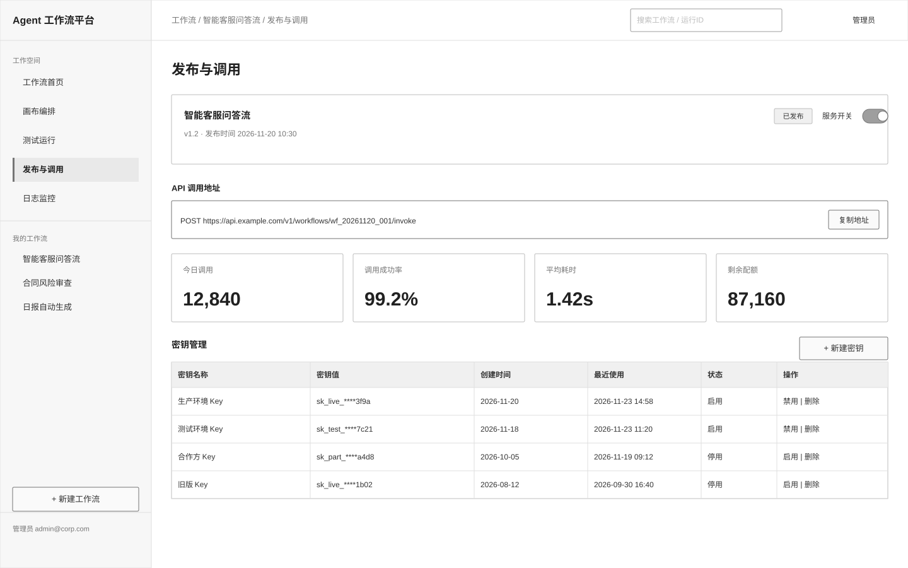
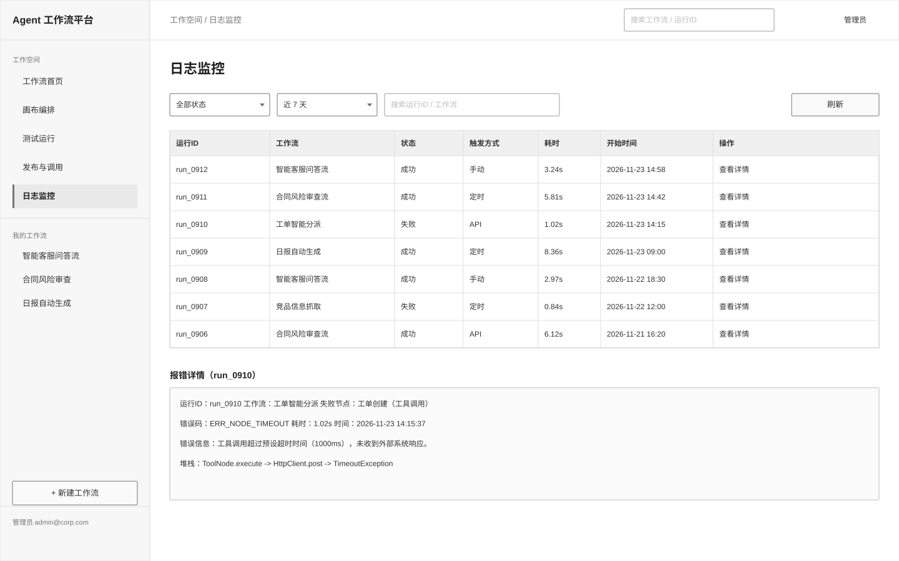

# 项目2：企业Agent智能工作流平台 PRD
## 1. 项目概述
### 1.1 背景
企业内部重复流程多（报表整理、工单分发、信息汇总），纯人工操作耗时、容易出错；依靠大模型Agent编排工具调用，自动串联多步骤任务。
### 1.2 项目目标
- 业务目标：高频重复工单处理效率提升60%，减少人工复制粘贴、跨系统查询工作
- 用户：业务运营、行政、客服、流程管理员
- 上线范围：内部灰度试用

## 2. 用户角色
1. 流程管理员：可视化编排Agent工作流、配置工具、调试流程、发布上线
2. 普通用户：启动已有流程、填写入参、查看任务执行结果、日志
3. 运营：查看流程执行统计、失败任务复盘

## 3. 功能需求
### 3.1 流程画布（核心）
- 可视化拖拽编排：大模型节点、HTTP接口节点、条件分支、循环节点、文本处理节点
- 节点配置：Prompt设置、模型选择、入参出参映射
- 流程保存、草稿、版本管理（回滚到历史版本）
- 调试模式：单步执行，查看每一步输出

### 3.2 任务运行模块
- 流程启动入口：表单填写参数，一键运行Agent
- 实时日志：每一步执行记录、模型返回内容、工具调用结果
- 任务状态：排队/运行中/成功/失败，失败支持重试
- 结果导出：支持导出文本、表格结果

### 3.3 工具管理
- 内置工具：文本提取、正则、JSON解析
- 自定义API工具：录入接口地址、请求头、参数，给Agent调用
- 工具权限管控：指定流程才可以调用敏感接口

### 3.4 数据看板
- 流程总执行次数、成功率、平均耗时
- 失败原因统计、高频使用流程排行

## 4. 非功能需求
- 稳定性：单流程最长运行超时限制120s
- 安全：接口密钥加密存储，日志脱敏屏蔽敏感信息
- 兼容：PC浏览器
- 限流：单用户同时最多运行3个任务

## 5. 业务规则
1. Agent严格按照编排节点顺序/分支逻辑执行，不擅自新增步骤
2. 分支判断由大模型+规则共同判定，支持固定值兜底
3. 流程发布后普通用户不可修改画布，仅管理员可编辑

## 6. 验收标准
1. 可拖拽搭建多分支Agent流程，正常跑完完整链路
2. 支持调用自定义API工具，参数传递正确
3. 调试模式可查看每一步日志，失败任务可重试
4. 版本保存、回滚功能可用

## 7. 原型说明
Figma低保原型页面：流程画布页、流程列表、任务详情日志页、工具配置弹窗、数据看板
原型链接：

