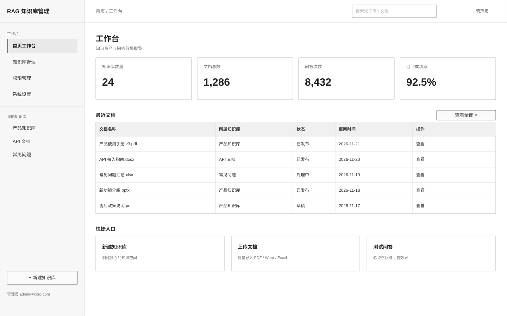
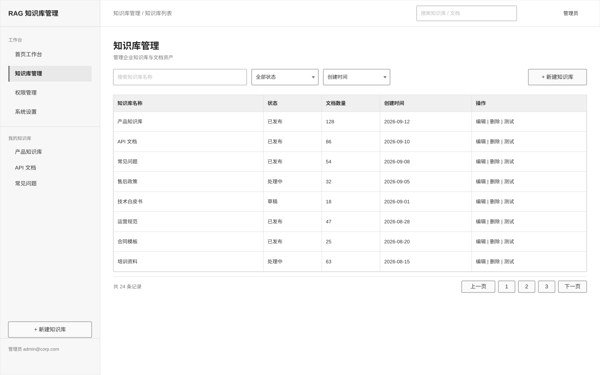
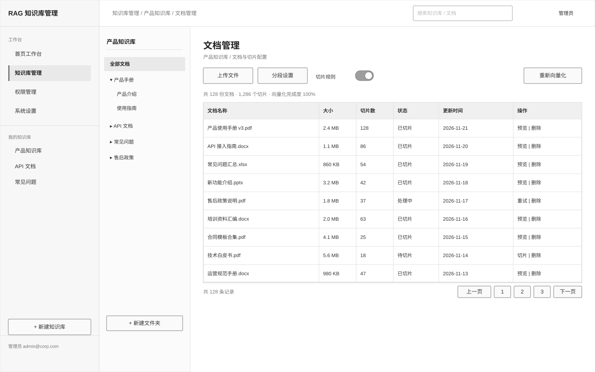
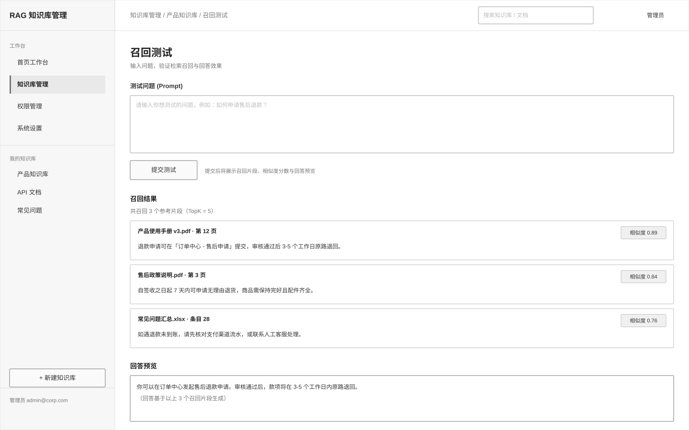
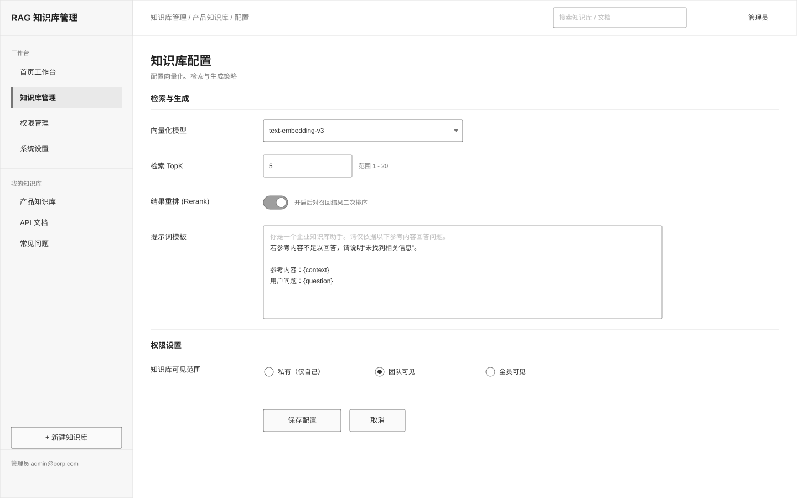
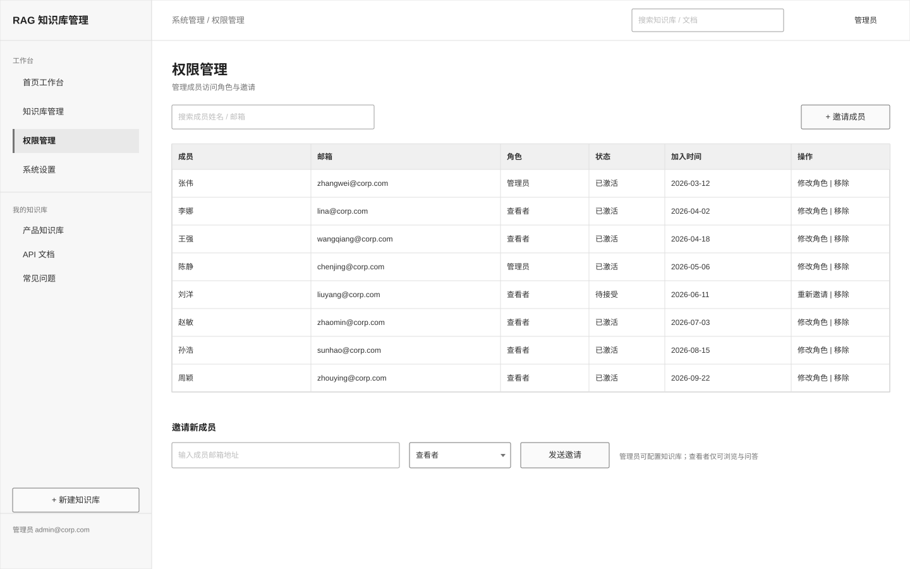

# 项目1：企业RAG知识库系统 PRD
## 1. 项目概述
### 1.1 背景
企业内部文档分散（合同、手册、制度），员工查找资料慢、咨询客服重复问题多；需要基于大模型搭建私有知识库，支持文档上传、智能问答、引用溯源。
### 1.2 目标
- 业务目标：自助问答解决率提升至55%+，减少人工咨询量
- 用户：企业内部员工、运营、客服
- 上线范围：灰度给内部部门试用

## 2. 用户角色
1. 管理员：上传/管理文档、设置权限、查看问答统计
2. 普通用户：提问、查看回答、查看引用来源
3. 运营：查看高频问题、知识库优化建议

## 3. 功能需求
### 3.1 知识库管理模块
- 文档上传：支持PDF、Word、TXT，单文件上限20MB
- 文档解析：自动分段、向量化入库；支持手动重分段
- 文档状态：待解析/解析成功/解析失败，失败可重试
- 文件夹分类：可以新建文件夹，归类不同业务文档
- 权限控制：文件夹可设置【全员可见】/【指定部门可见】

### 3.2 对话问答模块
- 输入框提问，支持上下文多轮对话
- 回答底部展示引用片段+来源文档链接
- 回答支持点赞/点踩（用于模型效果迭代）
- 支持清空对话、新建对话窗口

### 3.3 数据看板（管理员）
- 问答总量、成功回答数、好评率
- Top高频问题排行
- 文档调用次数统计

## 4. 非功能需求
- 安全：私有文档不对外泄露，模型不记忆敏感内容
- 性能：问答响应 < 8s；文档解析100页PDF ≤ 3min
- 兼容：PC端浏览器访问
- 限流：单用户每分钟最多10次提问

## 5. 业务规则
1. 模型只基于入库文档回答，超出知识库范围输出“暂无相关资料”
2. 点踩记录问题，同步给运营优化知识库
3. 删除文档后，该文档片段不再参与检索

## 6. 验收标准
1. 上传PDF/Word可正常解析、检索
2. 提问能匹配对应文档片段，附带引用溯源
3. 权限隔离：无权限用户看不到对应文件夹内容
4. 看板数据正常统计

## 7. 原型说明
Figma低保原型包含：登录页、知识库列表页、文档上传弹窗、对话页、后台数据看板
原型链接：

